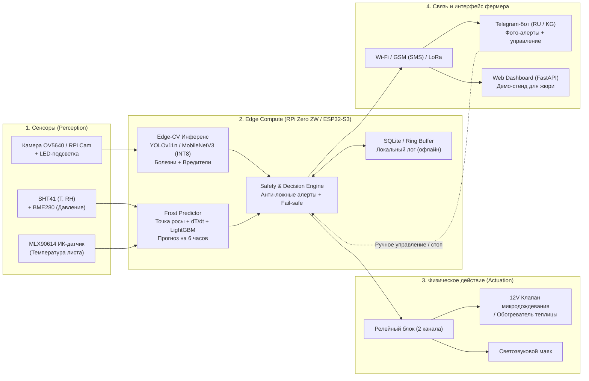

# Архитектура проекта: AgroGuard Edge
**Трек:** AgriTech & Food — *Проблема #02: Позднее выявление болезней и заморозков*  
**Хакатон:** Physical AI Hackathon (Бишкек, 5–6 декабря 2026)

---

## 1. Концепция продукта (2-в-1 Physical AI устройство)

**AgroGuard Edge** — автономный полевой/тепличный маяк, объединяющий два контура защиты урожая в одном корпусе:
1. **Контур зрения (Edge-CV):** раз в час фотографирует листья / клеевую ловушку, локально запускает нейросеть (без облака) и при обнаружении ранних признаков болезни или вредителей отправляет фото с разметкой и рекомендацией в Telegram/SMS.
2. **Контур микроклимата (Frost-Shield):** каждые 5 минут снимает температуру воздуха, **температуру поверхности листа (ИК)**, влажность и давление, локально прогнозирует заморозок на **6 часов вперёд** и **физически включает защиту** (клапан микродождевания / обогреватель / дымовую шашку через реле) до падения ниже 0°C.

---

## 2. Системная архитектура (End-to-End)



---

## 3. Аппаратная архитектура (Hardware & BOM)

### Рекомендуемая платформа
* **Для хакатона и быстрого MVP:** **Raspberry Pi Zero 2W** (4 ядра ARM, 512 МБ RAM, Wi-Fi/BLE, полноценный Linux + Python + ONNX/TFLite). Проще и в 5× быстрее в сборке за 48 часов, чем голый C++ на микроконтроллере.
* **Для массовой серии (v2):** связка **ESP32-S3** (микроклимат + реле + глубокий сон) + модульная камера (или LoRa-сеть: 10 дешёвых датчиков на 1 шлюз).

### Смета (BOM — Bill of Materials)

| Компонент | Назначение | Цена (прототип) | Цена (серия 1000+) |
|---|---|---|---|
| **Raspberry Pi Zero 2W** | Edge-вычисления (CV + ML + логика) | ~$18 | ~$12 (или ESP32-S3 ~$5) |
| **Камера OV5640 / RPi Cam** | Съёмка листьев и клеевой ловушки | ~$8 | ~$4 |
| **SHT41 / SHT31** | Точный датчик T и влажности (не боится росы) | ~$4 | ~$2 |
| **MLX90614 (ИК)** | Бесконтактная температура самого листа* | ~$6 | ~$3 |
| **BME280** | Атмосферное давление (индикатор ясной ночи) | ~$3 | ~$1.5 |
| **2-кан. реле + 12V клапан** | Физический запуск полива / обогрева | ~$8 | ~$4 |
| **Солнечная панель 10W + АКБ** | Автономное питание в саду/поле | ~$15 | ~$8 |
| **Корпус IP65 + крепление** | Защита от дождя, пыли и мороза | ~$6 | ~$3 |
| **ИТОГО** | | **~$68** | **~$30–37** |

> *Почему MLX90614 — киллер-фича для жюри:* в ясную безветренную ночь (радиационный заморозок) листья и цветки остывают на **2–4°C ниже температуры воздуха**. Обычные термометры опаздывают, а ИК-датчик ловит угрозу вовремя.

---

## 4. Архитектура Edge AI (две локальные модели)

### Модель A: Детекция болезней и вредителей (Computer Vision)
* **Архитектура:** `YOLO11n` (или `YOLOv8n` / `MobileNetV3-Small`), экспортированная в **ONNX / TFLite INT8**.
* **Размер и скорость:** ~3–6 МБ; время инференса на RPi Zero 2W ~350–700 мс (при частоте съёмки 1 раз в час — нагрузка на CPU около нуля).
* **Датасеты для обучения/файнтюнинга:**
  * **PlantVillage** (болезни томатов, яблок, картофеля, винограда: фитофтороз, мучнистая роса, парша, пятнистость).
  * **IP102 / Yellow Sticky Trap datasets** (тля, белокрылка, трипсы на жёлтой ловушке).
* **Защита от ложных срабатываний:**
  * Кольцевой белый LED включается на 1 сек во время съёмки (стабильный баланс белого).
  * Алерт уходит только при **confidence ≥ 0.75** на **2 последовательных кадрах** (или 2 из 3).
  * Отправляется кропнутое фото с рамкой (bounding box) → экономия трафика 90%.

### Модель B: Локальный прогноз заморозков на 6 часов (Time-Series ML + Физика)
* **Почему локально:** Прогноз погоды из интернета даёт температуру по городу/району с ошибкой ±4°C, тогда как заморозки бьют локально по низинам и конкретным садам.
* **Входные признаки (окно за последние 3–6 часов, шаг 5 мин):**
  1. $T_{air}$ (температура воздуха) и $T_{leaf}$ (температура листа).
  2. Относительная влажность $RH$ и **точка росы $T_{dew}$** (формула Магнуса):
     $$T_{dew} = \frac{243.12 \cdot \gamma}{17.62 - \gamma}, \quad \gamma = \ln\left(\frac{RH}{100}\right) + \frac{17.62 \cdot T}{243.12 + T}$$
  3. Скорость охлаждения $dT/dt$ (за 30, 60 и 180 мин).
  4. Тренд атмосферного давления $dP/dt$ (рост давления вечером = ясное небо → сильное выхолаживание).
  5. Синус/косинус времени суток (часы до рассвета).
* **Модель:** **LightGBM Regressor / Quantile Regression** (размер < 200 КБ, инференс < 5 мс), предсказывает $T_{min}$ через 2, 4 и 6 часов и вероятность $P(T < 0^\circ C)$.
* **Fail-safe (аппаратная страховка):** Жёсткое правило поверх ML — если $T_{leaf} \le +1.5^\circ C$ и $dT/dt < -0.3^\circ C/\text{ч}$, реле защиты включается безусловно.

---

## 5. Программный стек (Software & Firmware)

```text
agroguard-edge/
├── device/                     # Код на Raspberry Pi Zero 2W (или ноутбуке для демо)
│   ├── sensors/
│   │   ├── climate.py          # Чтение SHT41 + BME280 + MLX90614 (I2C) + режим симуляции
│   │   └── camera.py           # Захват фото (Picamera2 / OpenCV) + управление LED
│   ├── ai/
│   │   ├── disease_cv.py       # ONNX Runtime инференс (YOLO11n / MobileNetV3)
│   │   └── frost_predict.py    # Точка росы + LightGBM прогноз на 6 ч
│   ├── actuator/
│   │   └── relay.py            # Управление GPIO реле (полив / обогрев) + Watchdog
│   ├── storage/
│   │   └── local_db.py         # SQLite (хранение данных при потере сети)
│   └── main.py                 # Планировщик цикла (5 мин климат, 60 мин фото)
├── backend/                    # Лёгкий сервер + интерфейс фермера и жюри
│   ├── api.py                  # FastAPI (WebSocket телеметрия + ручное управление реле)
│   ├── telegram_bot.py         # Aiogram-бот (алерты с фото + кнопки RU/KG)
│   └── dashboard/              # Простой веб-дашборд (графики T/T_dew/прогноз + лента CV)
└── ml_training/                # Ноутбуки обучения и экспорта моделей в ONNX
    ├── train_disease_cv.ipynb
    └── train_frost_lgbm.ipynb
```

---

## 6. Сценарий «вау-демо» для жюри (на 2 минуты)

Даже если на хакатоне нет настоящей теплицы, на столе жюри собирается **живой интерактивный стенд**:

1. **Демо защиты от заморозков (30 сек):**
   * На экране дашборда идут живые показания датчика температуры и точки росы.
   * Прикладываем к датчику **пакет со льдом / баллончик с охладителем** → график падает → Edge-модель за секунду пересчитывает прогноз на 6 часов (`Риск заморозка: 94%`) → **слышно реальный щелчок реле, включается мини-помпа (микродождевание) / лампа-обогреватель**, и в Telegram-бот сразу прилетает алерт с кнопкой управления.
2. **Демо раннего выявления болезней (30 сек):**
   * Под камеру кладём реальный или распечатанный лист с пятнами (фитофтора / мучнистая роса).
   * Локальная CV-модель (при выключенном Wi-Fi, показывая офлайн-работу!) за <1 сек выделяет поражённую зону и при подключении шлёт фото-алерт фермеру с рекомендацией по обработке.
3. **Бизнес-цифры для WeFund Ventures и ПВТ (60 сек):**
   * Себестоимость узла в серии: **~$35**, цена продажи: **$99** + подписка **$5/мес** (SMS/Telegram-аналитика).
   * Один заморозок в Чуйской области или на Иссык-Куле уничтожает урожай сада на **$3 000–$15 000** → прибор окупается **в первую же ночь**.

---

## 7. Распределение задач в команде на 48 часов

* **День 1 (суббота):**
  * *Hardware / Embedded:* подключить датчики (I2C) + реле + мини-помпу/LED к RPi/ESP32 (или Arduino к ноутбуку), проверить чтение данных и щелчок реле.
  * *ML / CV:* взять предобученную модель болезней листьев (PlantVillage → ONNX INT8) + обучить LightGBM прогноза заморозков на открытых почасовых метеоданных (Open-Meteo по Бишкеку/Чуйской области за 3 года).
  * *Backend / UX:* поднять FastAPI + Telegram-бот (RU/KG) + простой веб-дашборд.
* **День 2 (воскресенье):**
  * Интеграция всех модулей в единый цикл (`сенсор → Edge AI → реле + Telegram`).
  * Прогон «стресс-теста» со льдом и тестовыми листьями (запасной режим симуляции на случай сбоя Wi-Fi в зале!).
  * Сборка питч-дека (боль → демо → архитектура → BOM/экономика → рынок КР/ЦА/мир).
