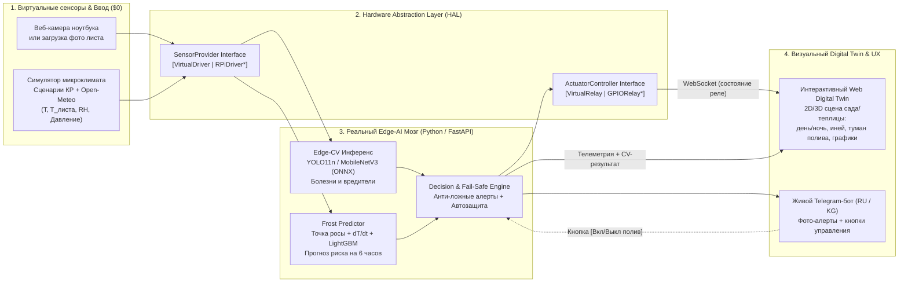

# Архитектура проекта: AgroGuard Edge (Virtual Digital Twin Edition)
**Трек:** AgriTech & Food — *Проблема #02: Позднее выявление болезней и заморозков*  
**Хакатон:** Physical AI Hackathon (Бишкек, 5–6 декабря 2026)  
**Формат MVP:** Виртуальный визуальный симулятор (Digital Twin) + реальные Edge-AI модели (**бюджет $0**)

---

## 1. Главная идея: «Настоящий ИИ-мозг + Виртуальный цифровой двойник»

По правилам хакатона физический прототип не обязателен — оцениваются сила идеи, техническая архитектура, реальная работа ИИ и масштабируемость. Поэтому мы строим **Hardware-Ready систему с бюджетом $0**:

* **ИИ на 100% настоящий:** реальная локальная CV-модель детекции болезней (работает с веб-камерой ноутбука или фото) + реальная ML-модель прогноза заморозков на 6 часов (обучена на реальных метеоданных Кыргызстана).
* **Железо заменено на интерактивный Digital Twin:** веб-интерфейс в реальном времени визуализирует сад/теплицу, датчики, падение температуры, появление инея и **анимированное срабатывание физического реле (микродождевание / обогрев)**.
* **Слой абстракции железа (HAL):** код спроектирован через интерфейсы `SensorProvider` и `ActuatorController`. На хакатоне подключён `VirtualTwinDriver`, а после привлечения финансирования достаточно переключить флаг конфига на `RaspberryPiDriver` / `ESP32Driver` — **без переписывания ИИ и бэкенда**.

---

## 2. Системная архитектура (Virtual Digital Twin + Hardware-Ready)



> `*` *Модули `RPiDriver` и `GPIORelay` описаны в архитектуре как plug-and-play переход на физический узел (BOM ~$35 в серии).*

---

## 3. Из чего состоит визуальный проект (4 экрана / модуля в одном дашборде)

### Модуль 1: Интерактивный Digital Twin сада / теплицы (Visual Scene)
Центральная визуальная панель в браузере (SVG/Canvas или Three.js):
* Отображает грядки/деревья, установленный маяк AgroGuard, датчики и систему микродождевания/обогрева.
* **Динамическая реакция на состояние среды:**
  * При снижении $T_{leaf}$ к $0^\circ C$ картинка плавно переходит в ночной режим, на листьях появляется визуальный эффект инея, а карточка тревоги загорается красным.
  * Как только Edge-модель прогнозирует заморозок — **виртуальное реле щёлкает (`ON`)**, и на сцене запускается анимация **водяного тумана (микродождевания)** или тёплого свечения обогревателя, стабилизируя температуру листьев.
  * При обнаружении болезни на конкретном секторе подсвечивается очаг заражения.

### Модуль 2: «Машина времени» и симулятор погоды КР (Scenario Simulator)
Позволяет за **15 секунд на питче** показать жюри целую ночь заморозков:
* **Готовые пресеты на реальных данных Open-Meteo:**
  * *«Апрельский возвратный заморозок — Чуйская долина»* (резкое падение с +9°C до −3°C к 04:00).
  * *«Ясная ночь — Иссык-Куль»* (радиационное охлаждение листа на 3°C ниже воздуха).
  * *«Теплица: высокая влажность (риск грибка)»*.
* **Ручные слайдеры:** температура воздуха, влажность, давление, скорость ветра — жюри может само покрутить ползунки и увидеть мгновенную реакцию ИИ и реле.
* **Режим реальной погоды:** подтягивает текущую погоду в Бишкеке/регионах КР через бесплатный **Open-Meteo API** (без ключа).

### Модуль 3: Живой Edge-CV сканер болезней (Real AI)
* Работает с **веб-камерой ноутбука** в реальном времени или через **drag-and-drop фото листа** (плюс встроенная галерея тестовых примеров: здоровый лист, фитофтороз, мучнистая роса, парша яблони, тля).
* Запускает локальную **ONNX-модель** (`MobileNetV3` / `YOLO11n`, обучена на датасете **PlantVillage**) без внешних платных API.
* Показывает:
  * Фото с выделенной зоной поражения (bounding box / heatmap);
  * Диагноз + % уверенности + время инференса в мс (доказывает, что модель легко пойдёт на дешёвом RPi/ESP32);
  * Конкретную рекомендацию фермеру на **русском и кыргызском языках**.

### Модуль 4: Живой Telegram-бот фермера (Free UX)
* Работает бесплатно через официальный Telegram Bot API (`aiogram`).
* Как только в симуляторе возникает риск заморозка или CV находит болезнь, бот **в реальном времени** присылает сообщение на телефон с фото, прогнозом и inline-кнопками:
  * `[💧 Включить микродождевание]` / `[⏹ Остановить]` / `[🤖 Авто-режим: ВКЛ]`
* Нажатие кнопки в Telegram **тут же меняет состояние реле и анимацию на экране Digital Twin** через WebSocket.

---

## 4. Архитектура двух реальных AI-моделей

### A. Модель прогноза заморозков на 6 часов (`frost_predict.py`)
* **Физика + ML:** вычисляет **точку росы ($T_{dew}$)** по формуле Магнуса, скорость охлаждения $dT/dt$, перепад $T_{air} - T_{leaf}$ и тренд давления $dP/dt$.
* **Алгоритм:** лёгкий **LightGBM** (< 200 КБ, инференс < 5 мс), обученный на бесплатных 3-летних почасовых данных Open-Meteo по Чуйской и Иссык-Кульской областям.
* **Выход:** график прогноза температуры на +6 часов, вероятность заморозка $P(T < 0^\circ C)$ и рекомендуемое действие.
* **Fail-safe правило:** если $T_{leaf} \le +1.5^\circ C$ и температура падает — защита включается автоматически независимо от ML.

### B. Модель детекции болезней (`disease_cv.py`)
* **Алгоритм:** `MobileNetV3-Small` / `YOLO11n` в формате **ONNX INT8** (3–6 МБ).
* **Классы MVP (6–8 самых актуальных для КР):** здоровый лист, мучнистая роса, фитофтороз, парша яблони, бактериальная пятнистость, поражение вредителями.
* **Почему это Edge AI:** на презентации можно отключить интернет на ноутбуке и показать, что детекция болезней и прогноз заморозков продолжают работать локально за миллисекунды.

---

## 5. Бесплатный технологический стек ($0 Stack)

| Слой | Технологии | Стоимость |
|---|---|---|
| **Backend & AI Core** | Python 3.11+, FastAPI, WebSockets, ONNX Runtime, LightGBM, NumPy | **$0** |
| **Frontend (Digital Twin)** | React + Vite (или Next.js), Tailwind CSS, Recharts, Canvas/SVG анимации | **$0** |
| **Telegram-бот** | Python `aiogram 3` (поддержка RU / KG) | **$0** |
| **Данные погоды** | Open-Meteo API (история + live погода по КР без API-ключа) | **$0** |
| **Хранение логов** | SQLite (локально) | **$0** |
| **Запуск на питче** | Локально на ноутбуке (100% устойчивость к сбоям Wi-Fi) + опционально Vercel/Render | **$0** |

---

## 6. Структура репозитория для разработки

```text
agriculture/
├── README.md                              # Описание проекта для GitHub и жюри
├── ARCHITECTURE.md                        # Эта техническая архитектура
├── Physical_AI_Hackathon_Research.pdf     # Ресерч по 5 трекам хакатона
├── backend/                               # FastAPI + AI-модели + Симулятор + Telegram-бот
│   ├── main.py                            # REST + WebSocket сервер
│   ├── hal/                               # Hardware Abstraction Layer
│   │   ├── interfaces.py                  # Абстрактные SensorProvider / ActuatorController
│   │   └── virtual_driver.py              # Виртуальные датчики, сценарии КР и реле
│   ├── ai/
│   │   ├── disease_cv.py                  # Локальный ONNX-инференс болезней листьев
│   │   └── frost_predict.py               # Точка росы + LightGBM прогноз на 6 часов
│   └── bot/
│       └── telegram_bot.py                # Живые алерты и управление реле из Telegram
└── frontend/                              # Интерактивный Web Digital Twin
    └── src/
        ├── components/
        │   ├── FieldDigitalTwin.tsx       # Визуальная сцена сада/теплицы с анимацией
        │   ├── ClimateControls.tsx        # Пресеты КР, слайдеры и «машина времени»
        │   ├── DiseaseScanner.tsx         # Веб-камера / загрузка фото + диагноз
        │   └── TelemetryCharts.tsx        # Живые графики T, T_dew и прогноза на 6 ч
        └── App.tsx
```

---

## 7. Переход от Digital Twin к реальному железу (Hardware Roadmap)

Для инвесторов (WeFund Ventures / ПВТ) важно видеть, как виртуальный прототип превращается в реальный продукт после хакатона:

1. **Этап 1 (Хакатон, $0):** Валидация AI-моделей, UX фермера и логики автозащиты на Digital Twin.
2. **Этап 2 (Пилот в 1 теплице, ~$70):** Замена `VirtualDriver` → `RaspberryPiDriver` (RPi Zero 2W + SHT41 + MLX90614 + камера + 12V клапан).
3. **Этап 3 (Серия, BOM ~$30–35):** Перенос моделей на ESP32-S3 + солнечная панель + LoRa/GSM; продажа за **$99** (окупаемость для фермера — 1 спасённая ночь заморозков).
