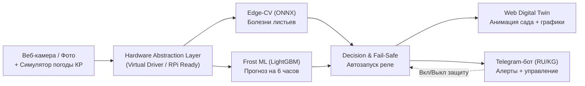

# 🌱 AgroGuard Edge — Digital Twin & Physical AI для защиты урожая

> **Проект для [Physical AI Hackathon](https://www.instagram.com/startuplab119/) (Бишкек, 5–6 декабря 2026)**  
> **Трек:** `AgriTech & Food` — Умное сельское хозяйство  
> **Формат MVP:** Интерактивный виртуальный цифровой двойник (Digital Twin) + реальные локальные Edge-AI модели (**$0 на железо**, готовая архитектура под перенос на микроконтроллер).

---

## 🎯 Какую проблему мы решаем

Фермеры и садоводы Кыргызстана и Центральной Азии ежегодно теряют **20–35% урожая** из-за двух критических факторов:
1. **Позднее выявление болезней и вредителей:** грибок и вредители замечают визуально только тогда, когда поражено >30% теплицы или сада.
2. **Весенние возвратные заморозки:** за одну ясную ночь температура поверхности листьев и цветков падает на 2–4°C ниже прогноза погоды по району, уничтожая сады на тысячи долларов.

---

## 💡 Наше решение

**AgroGuard Edge** — это 2-в-1 система раннего предупреждения и автоматической защиты урожая, работающая **локально (Edge AI)** без зависимости от стабильного интернета и дорогих облачных API:

* **🔍 Edge-CV сканер болезней:** локальная нейросеть (`ONNX INT8`) анализирует фото листьев (с веб-камеры или загруженного снимка), находит ранние признаки болезней (фитофтороз, мучнистая роса, парша и др.) и выдаёт рекомендации на русском и кыргызском.
* **❄️ Прогноз заморозков на 6 часов:** физико-ML модель (точка росы по Магнусу + градиент охлаждения + `LightGBM`) предсказывает заморозок заранее и **автоматически запускает физическую защиту** (микродождевание / обогрев через реле).
* **🖥️ Интерактивный визуальный Digital Twin:** веб-симулятор сада/теплицы в реальном времени показывает смену дня/ночи, появление инея, графики микроклимата и анимированное срабатывание форсунок полива/обогрева.
* **📲 Живой Telegram-бот фермера:** отправляет фото-алерты с диагнозом и позволяет одной кнопкой управлять защитой (команды из Telegram мгновенно обновляют цифровой двойник).
* **🔌 Hardware-Ready (HAL):** архитектура отделяет ИИ-мозг от железа — после хакатона виртуальный драйвер меняется на реальные датчики (`RPi Zero 2W / ESP32-S3 + SHT41 + MLX90614 + реле`) без переписывания логики.

---

## 🏗️ Как устроена система

Подробная техническая спецификация, стек, структура кода и переход на физическое железо (BOM ~$35 в серии) описаны в **[ARCHITECTURE.md](ARCHITECTURE.md)**.

---

## 📂 Содержимое репозитория

| Файл | Описание |
|---|---|
| [`README.md`](README.md) | Обзор проекта, проблемы, решения и демо-сценария |
| [`ARCHITECTURE.md`](ARCHITECTURE.md) | Полная архитектура виртуального Digital Twin, AI-моделей, стека ($0) и roadmap на железо |
| [`Physical_AI_Hackathon_Research.pdf`](Physical_AI_Hackathon_Research.pdf) | Ресерч-презентация по всем 5 трекам хакатона (15 проблем и 30 вариантов Physical AI решений) |

---

## 🎬 Что увидит жюри на 2-минутном демо

1. **«Машина времени» заморозка (30 сек):** запускаем сценарий *«Апрельский заморозок — Чуйская долина»* (6 часов за 15 секунд) → графики $T$ и точки росы падают → модель прогнозирует риск >90% → на визуальной сцене автоматически включается микродождевание, а в Telegram прилетает алерт.
2. **Офлайн Edge-CV диагностика (30 сек):** показываем в веб-камеру (или загружаем) фото листа с болезнью → локальная модель за <0.5 сек определяет заболевание, подсвечивает очаг и отправляет фото с рекомендацией фермеру.
3. **Экономика и масштаб (60 сек):** себестоимость серийного устройства **~$35**, цена продажи **$99** — окупается за **одну** спасённую ночь весенних заморозков; масштабируется на сады и теплицы всего Кыргызстана и Центральной Азии.

---

## 🧰 Стек технологий (100% Open-Source / $0)

* **AI & Backend:** Python, FastAPI, WebSockets, ONNX Runtime, LightGBM, Aiogram (Telegram Bot)
* **Frontend (Digital Twin):** React / Vite, Tailwind CSS, Recharts, Canvas/SVG анимации
* **Метеоданные:** Open-Meteo API (реальные данные по регионам Кыргызстана)
* **Будущее железо (v1):** Raspberry Pi Zero 2W / ESP32-S3, SHT41, MLX90614 (ИК-датчик листа), BME280, 12V клапан
